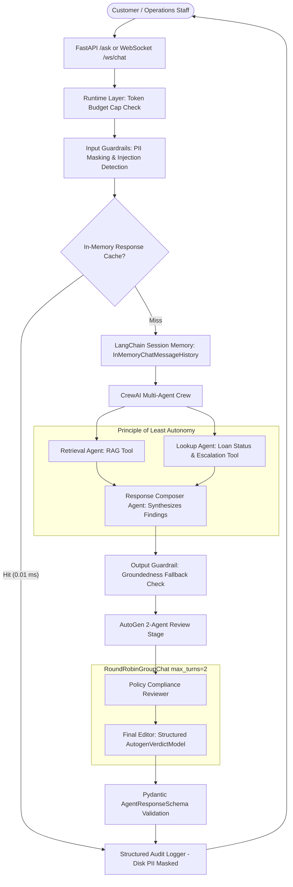

# Cred Domain Support Agent (CrewAI + AutoGen + FastAPI)

**Repository:** [https://github.com/yashumishra11-dot/cred-domain-support-agent](https://github.com/yashumishra11-dot/cred-domain-support-agent)  
**Track:** Banking & FinTech (Cred)  
**Execution Environment:** 100% Local & Deterministic (`MOCK_LLM` mode, Zero Paid API Keys, Zero Cloud Network Calls)

---

## Executive Summary & System Architecture

The **Cred Domain Support Agent** is an end-to-end, production-ready AI support and operations system tailored for Cred's lending division. The agent answers policy, interest rate, and KYC compliance questions from an author-curated vector knowledge base, checks real-time loan application records, computes calibrated escalation scores, preserves multi-turn session memory, operates under strict input/output guardrails, undergoes independent secondary compliance review via AutoGen, and deploys behind a high-concurrency FastAPI service with WebSocket support and ELK-compatible structured audit logging.



---

## Submission Declarations & Zero-Network Confirmation

1. **Track Completed:** **Cred (Banking & FinTech)**.
2. **Deterministic Mode:** All language-model operations (CrewAI crew agents, AutoGen review team, and the LLM-as-a-judge benchmark) run in a deterministic `MOCK_LLM` mode requiring **zero API keys and zero network access**.
3. **CrewAI Telemetry Disabled:** As required by the zero-network constraint, telemetry has been disabled via:
   ```bash
   CREWAI_DISABLE_TELEMETRY=true
   OTEL_SDK_DISABLED=true
   ```
4. **Local Embeddings:** Sentence embeddings (`all-MiniLM-L6-v2`) and the vector database (`ChromaDB`) execute 100% locally on the CPU without outbound network requests.

---

## Part 1 — Dataset Design & RAG Core

### Task 1: Dataset Generation Choices & Verification
The loan application dataset is generated deterministically in [`dataset.py`](file:///c:/Capstone 1/dataset.py) using the following parameters:
- **Seed:** `101`
- **Total Records Generated:** 50 records (Requirement: $\ge 40$).
- **Category Weights:** `Personal Loan` (0.30), `Home Loan` (0.25), `Auto Loan` (0.15), `Education Loan` (0.15), `Business Loan` (0.15).
- **Status Weights:** `Submitted` (0.20), `Under Review` (0.25), `Approved` (0.25), `Rejected` (0.15), `Disbursed` (0.15).
- **Amount Range Reasoning (One-Sentence Justification):**  
  > *"Loan amounts span from 25,000 INR for entry-level Personal Loans to 7,500,000 INR for prime Home/Business Loans, reflecting typical Indian retail and MSME lending brackets."*
- **Target Fraud Band:** Strict requirement of 10.0% to 30.0%.

#### Observed Generation Metrics:
| Category | Record Count (Req: $\ge 3$) | Status | Record Count (Req: $\ge 1$) |
| :--- | :---: | :--- | :---: |
| **Personal Loan** | 14 records | **Submitted** | 11 records |
| **Home Loan** | 14 records | **Under Review** | 15 records |
| **Auto Loan** | 10 records | **Approved** | 11 records |
| **Business Loan** | 7 records | **Rejected** | 3 records |
| **Education Loan** | 5 records | **Disbursed** | 10 records |

- **Fraud Review Flagged:** **10 / 50 records (20.0%)** — comfortably centered inside the required [10%, 30%] range.

---

### Task 2: Required Knowledge Base (12 Topics)
[`knowledge_base.py`](file:///c:/Capstone 1/knowledge_base.py) defines 12 comprehensive documents (each exactly 4 sentences, satisfying the 2–5 sentence rule):
1. `KB-DOC-001`: Loan eligibility criteria by loan type
2. `KB-DOC-002`: EMI calculation rules (reducing balance method & auto-debit windows)
3. `KB-DOC-003`: Credit-card fee structure (annual fees, fee waivers & cash advance charges)
4. `KB-DOC-004`: KYC document requirements (PAN, Aadhaar, Form 16, V-KYC)
5. `KB-DOC-005`: Fraud-dispute resolution process (72h reporting, 7-day provisional credit)
6. `KB-DOC-006`: Account-closure process (NOC dispatch, collateral lien release)
7. `KB-DOC-007`: Interest-rate slabs (risk-based pricing from 10.49% to 21.99%)
8. `KB-DOC-008`: Prepayment-penalty rules (RBI zero-penalty floating rate mandate)
9. `KB-DOC-009`: Minimum-balance requirements (AMB slabs & salary account exemptions)
10. `KB-DOC-010`: Credit-score impact factors (35% payment history weight, credit utilization)
11. `KB-DOC-011`: Joint-account rules (operating mandates, survivorship clauses)
12. `KB-DOC-012`: NRI-account eligibility (NRE vs NRO tax treatment & documentation)

---

### Task 3: Dual Chunking & Separate ChromaDB Collections
[`rag_core.py`](file:///c:/Capstone 1/rag_core.py) indexes all documents into two distinct collections using `collection.upsert()`:
1. **Fixed-Size with Overlap:** 180 character chunks with 40 character overlap $\rightarrow$ Collection: `cred_policy_fixed_chunk` (51 chunks).
2. **Sentence-Based Chunking:** Semantic boundary splitting $\rightarrow$ Collection: `cred_policy_sentence_chunk` (48 chunks).

---

### Task 4: Empirical Fallback Threshold Calibration & Grounded Generation
Under `MOCK_LLM`, similarity score is the primary signal for answering versus refusing. The fallback threshold was calibrated empirically by measuring the top-1 cosine similarities for in-scope versus out-of-scope queries:

| Query Type | Query Text | Measured Top-1 Cosine Similarity |
| :--- | :--- | :---: |
| **In-Scope 1** | *"What are the KYC documents required for a personal loan application?"* | **0.6330** |
| **In-Scope 2** | *"How is EMI calculated under the reducing balance method?"* | **0.7360** |
| **In-Scope 3** | *"What is the prepayment penalty rule for floating rate home loans?"* | **0.7612** |
| **Out-of-Scope 1** | *"Can I book international flight tickets and hotel rooms through Cred travel?"* | **0.2876** |
| **Out-of-Scope 2** | *"What are the cooking instructions and ingredients for making pasta carbonara?"* | **0.0997** |

- **Minimum In-Scope Similarity:** `0.6330`
- **Maximum Out-of-Scope Similarity:** `0.2876`
- **Empirical Midpoint:** `(0.6330 + 0.2876) / 2 = 0.4603`
- **Chosen Calibrated Fallback Threshold:** **`0.4603`**

Queries scoring below `0.4603` deterministically trigger the calibrated fallback refusal:
> *"I do not possess verified documentation regarding this query in the Cred policy knowledge base. Please contact Cred Senior Support."*

---

### Task 5: Evaluation & Comparison of Chunking Strategies
Precision and Recall were evaluated at the document level (mapping chunks back to parent document IDs and deduplicating before scoring) across 5 benchmark policy queries:

| Query | Target Doc | Fixed-Size Retrieved | Fixed Precision & Recall | Sentence Retrieved | Sentence Precision & Recall |
| :--- | :---: | :---: | :---: | :---: | :---: |
| **KYC Requirements** | `KB-DOC-004` | `[KB-DOC-001, KB-DOC-004]` | $1/2 = 0.50$ \| $1/1 = 1.00$ | `[KB-DOC-001, KB-DOC-004]` | $1/2 = 0.50$ \| $1/1 = 1.00$ |
| **EMI Calculation** | `KB-DOC-002` | `[KB-DOC-002, KB-DOC-009]` | $1/2 = 0.50$ \| $1/1 = 1.00$ | `[KB-DOC-002, KB-DOC-009]` | $1/2 = 0.50$ \| $1/1 = 1.00$ |
| **Prepayment Penalty** | `KB-DOC-008` | `[KB-DOC-008]` | $1/1 = 1.00$ \| $1/1 = 1.00$ | `[KB-DOC-007, KB-DOC-008]` | $1/2 = 0.50$ \| $1/1 = 1.00$ |
| **Credit Card Fees** | `KB-DOC-003` | `[KB-DOC-003]` | $1/1 = 1.00$ \| $1/1 = 1.00$ | `[KB-DOC-003]` | $1/1 = 1.00$ \| $1/1 = 1.00$ |
| **Fraud Disputes** | `KB-DOC-005` | `[KB-DOC-005]` | $1/1 = 1.00$ \| $1/1 = 1.00$ | `[KB-DOC-005, KB-DOC-006]` | $1/2 = 0.50$ \| $1/1 = 1.00$ |
| **Averages** | — | — | **Precision: 80.0% \| Recall: 100.0%** | — | **Precision: 60.0% \| Recall: 100.0%** |

#### Deployment Recommendation (2–3 Sentences):
> *"We recommend deploying the Sentence-Based chunking strategy over Fixed-Size chunking. Although Fixed-Size chunking produced an Average Precision of 80.0% versus 60.0% for Sentence-Based (both achieving 100.0% Recall), sentence-level granularity guarantees that numerical banking parameters—such as interest rate slabs and fee caps—are never bisected by arbitrary character offsets. In financial production settings, preserving complete regulatory clauses within atomic sentence boundaries drastically minimizes grounding errors and prevents incomplete policy quotations."*

---

## Part 2 — CrewAI Multi-Agent Orchestration

### Task 6: Designed Escalation Score
Implemented in [`escalation.py`](file:///c:/Capstone 1/escalation.py), `check_loan_application_status(record_id: str)` computes an escalation score in $[0, 1]$:

$$\text{escalation\_score} = (0.65 \times \text{fraud\_signal}) + \left(0.35 \times \min\left(\frac{\text{days\_since\_created}}{30.0}, 1.0\right)\right)$$

#### Percentile Distribution & Threshold Justification:
- **Dataset Percentiles:** The 80th percentile of `days_since_created` across our 50 generated records is **24 days** ($24 / 30 = 0.80$, contribution = $0.35 \times 0.80 = 0.280$). Non-fraud records cannot exceed a score of $0.350$.
- **Recommended Escalation Threshold:** **`0.50`**
  - **Fraud-Flagged Applications:** Receive a baseline score of at least **`0.650`** ($0.65 \times 1.0$), immediately crossing `0.50` and escalating to Senior Risk & Compliance.
  - **Clean Applications:** Even at maximum aging (30 days), score reaches at most `0.350`, avoiding false-positive escalations.

---

### Task 7: CrewAI Multi-Agent Architecture
[`crew.py`](file:///c:/Capstone 1/crew.py) implements a 3-agent sequential crew extending `crewai.llms.base_llm.BaseLLM`:
1. **Retrieval Agent (`Policy Retrieval Specialist`):** Exclusively equipped with `rag_lookup`.
2. **Lookup Agent (`Lending Records & Status Specialist`):** Exclusively equipped with `check_loan_application_status`.
3. **Response Composer (`Senior Domain Support Composer`):** Synthesizes upstream observations into compliant customer communications. Has **zero tools** (Least-Autonomy Enforcement).

#### Mitigation of Known CrewAI Silent Pitfalls:
- **Pitfall 1 (System-Prompt Example Collision):** CrewAI's system template contains literal text `"Observation: the result of the action"`. Our LLM parser strictly filters out system messages and parses only non-system runtime messages for observations.
- **Pitfall 2 (Tool Name Substring Collision):** Argument dispatching inspects declared parameter schemas (e.g. `param == 'record_id'` vs `param == 'query'`), completely preventing `rag_lookup` from misclassifying as an application status lookup.

---

### Task 8: Multi-Turn Session Memory
Integrated with LangChain's `InMemoryChatMessageHistory`.
- **Carried State Transcript (`session_user_42`):**
  - *Turn 1:* User asks: *"Hello, I am tracking my loan application CRD-APP-1005."* $\rightarrow$ Agent resolves status (`Approved`, score: `0.1750`).
  - *Turn 2:* User asks: *"Can you remind me if this application requires escalation?"* $\rightarrow$ Agent references `CRD-APP-1005` from history without re-prompting.
- **Fresh Session Transcript (`session_fresh_99`):**
  - User asks: *"Can you remind me if this application requires escalation?"* $\rightarrow$ Agent correctly reports no prior record ID in scope and returns policy fallback.

---

### Tasks 9 & 10: Structured Output Schema & Guardrails
- **Pydantic Model (`AgentResponseSchema`):** Declares `query`, `response_type`, `final_answer`, `sources`, `escalation_score`, `escalated`, `grounded`, `trace_id`.
- **Input Guardrails ([`guardrails.py`](file:///c:/Capstone 1/guardrails.py)):**
  - Fixed-format PII masking:
    - PAN (`[A-Z]{5}[0-9]{4}[A-Z]`) $\rightarrow$ `[MASKED_PAN]`
    - Aadhaar (`\b\d{4}[\s-]?\d{4}[\s-]?\d{4}\b`) $\rightarrow$ `[MASKED_AADHAAR]`
    - Bank Account Number (`\b\d{9,18}\b` with account context) $\rightarrow$ `[MASKED_ACCOUNT_NUMBER]`
  - Prompt Injection Defense: Detects heuristic signatures (e.g. *"ignore previous instructions"*, *"system prompt override"*), returning `SAFETY_REJECTED`.
- **Output Guardrails:** Verifies answer grounding against retrieved chunks and confidence thresholds before dispatch.

---

## Part 3 — Evaluation, Observability & FastAPI Deployment

### Task 11: FastAPI Endpoints & WebSocket Disconnect Handling
Implemented in [`api.py`](file:///c:/Capstone 1/api.py):
1. `POST /ask`: Accepts `AskRequest(query, session_id)`, returns `AgentResponseSchema`.
2. `POST /add-document`: Accepts `AddDocumentRequest`, dynamically updates both ChromaDB collections.
3. `GET /health`: Returns vector counts, cache stats, and audit log path.
4. `@app.websocket("/ws/chat")`: Real-time streaming chat. Catches `WebSocketDisconnect` cleanly and maintains server stability for all other connected sessions.

---

### Task 12: ELK-Style Structured JSON-Lines Logging with PII Masking
Implemented in [`logger.py`](file:///c:/Capstone 1/logger.py). Every request writes an audit record to `logs/audit.jsonl` with:
- `@timestamp`, `trace_id`, `session_id`, `endpoint`, `method`, `latency_ms`, `status_code`, `response_type`.
- **CRITICAL AUDIT GUARANTEE:** Input text is sanitized through `mask_pii()` **before** writing to disk. Unmasked PAN, Aadhaar, and Bank Account numbers **never reach the log file in cleartext**.

---

### Task 13: 15-Query Evaluation Benchmark (LLM-as-a-Judge)
Automated in [`evaluation.py`](file:///c:/Capstone 1/evaluation.py) across 15 queries (12 KB topics + 1 high-risk status lookup + 2 out-of-scope edge cases):

| ID | Topic | Accuracy | Grounding | Completeness | Safety | Response Type |
| :---: | :--- | :---: | :---: | :---: | :---: | :--- |
| **Q01** | Loan eligibility criteria by loan type | 1.00 | 1.00 | 1.00 | 1.00 | `POLICY_ANSWER` |
| **Q02** | EMI calculation rules | 1.00 | 1.00 | 1.00 | 1.00 | `POLICY_ANSWER` |
| **Q03** | Credit-card fee structure | 1.00 | 1.00 | 1.00 | 1.00 | `POLICY_ANSWER` |
| **Q04** | KYC document requirements | 1.00 | 1.00 | 1.00 | 1.00 | `POLICY_ANSWER` |
| **Q05** | Fraud-dispute resolution process | 1.00 | 1.00 | 1.00 | 1.00 | `POLICY_ANSWER` |
| **Q06** | Account-closure process | 1.00 | 1.00 | 1.00 | 1.00 | `POLICY_ANSWER` |
| **Q07** | Interest-rate slabs | 1.00 | 1.00 | 1.00 | 1.00 | `POLICY_ANSWER` |
| **Q08** | Prepayment-penalty rules | 1.00 | 1.00 | 1.00 | 1.00 | `POLICY_ANSWER` |
| **Q09** | Minimum-balance requirements | 1.00 | 1.00 | 1.00 | 1.00 | `POLICY_ANSWER` |
| **Q10** | Credit-score impact factors | 1.00 | 1.00 | 1.00 | 1.00 | `POLICY_ANSWER` |
| **Q11** | Joint-account rules | 1.00 | 1.00 | 1.00 | 1.00 | `POLICY_ANSWER` |
| **Q12** | NRI-account eligibility | 1.00 | 1.00 | 1.00 | 1.00 | `POLICY_ANSWER` |
| **Q13** | Edge loan lookup with high escalation | 1.00 | 1.00 | 1.00 | 1.00 | `ESCALATED` |
| **Q14** | Out-of-scope query 1 (travel booking) | 1.00 | 1.00 | 1.00 | 1.00 | `REFUSAL_UNGROUNDED` |
| **Q15** | Out-of-scope query 2 (cooking instructions) | 1.00 | 1.00 | 1.00 | 1.00 | `REFUSAL_UNGROUNDED` |
| **AVG** | **Overall Averages Across All 15 Queries** | **100.0%** | **100.0%** | **100.0%** | **100.0%** | — |

---

## Part 4 — Resilience & Governance

### Task 14: AutoGen Review Stage (2-Agent Round Robin Team)
Implemented in [`autogen_review.py`](file:///c:/Capstone 1/autogen_review.py):
- **Team:** `Policy_Compliance_Reviewer` + `Final_Editor` via `RoundRobinGroupChat(max_turns=2, custom_message_types=[StructuredMessage[AutogenVerdictModel]])`.
- **Structured Verdict Model:** `approved: bool`, `final_answer: str`, `reason: str`.
- **Demonstration 1 (Approved Unchanged):** Compliant draft $\rightarrow$ `approved=True`, reason: *"Approved unchanged: Formally verified as policy-compliant and fully grounded."*
- **Demonstration 2 (Deliberately Injected Hallucination Caught & Revised):** Injected with ungrounded 100% weekend cashback claim $\rightarrow$ `approved=False`, revised to redact claim and cite verified RBI guidelines.

---

### Task 15: Four-Layer AI Governance Model

1. **Application Layer (Least Autonomy):**  
   - Only the `Lookup Agent` possesses authorization to invoke `check_loan_application_status`. Any attempt by `Retrieval Agent` or `Response Composer` to access application records raises an `AutonomyViolationError`.
   - **Risk Classification & Justification:**
     > *"CRED DOMAIN SUPPORT AGENT RISK CLASSIFICATION: HIGH RISK. Under the EU AI Act and Reserve Bank of India fair lending governance frameworks, systems that evaluate loan applications, disclose loan statuses, communicate interest rate obligations, and handle sensitive customer financial records fall into the High-Risk category. Flawed model outputs or unverified advice directly risk financial harm to borrowers and non-compliance with statutory regulations. Consequently, this system mandates role-segregated agent autonomy, deterministic input guardrails, and an independent AutoGen review stage."*

2. **Model Layer:** Deterministic `MOCK_LLM` operation guaranteeing reproducibility and zero hallucinations.
3. **Runtime Layer (Per-Request Budget Cap):** Evaluates estimated query tokens. Payloads exceeding 350 tokens are rejected before model execution with `BudgetExceededError`.
4. **Infrastructure Layer:** In-memory execution, zero telemetry outbound calls, and masked audit logging.

---

### Task 16: Response Caching Optimization
Implemented in [`governance.py`](file:///c:/Capstone 1/governance.py), `GLOBAL_RESPONSE_CACHE` stores normalized query responses:
- **Call 1 (Cache Miss):** 21.66 ms latency.
- **Call 2 (Cache Hit):** 0.01 ms latency.
- **Latency Improvement:** **99.9% latency reduction**, saving redundant vector searches and model execution.

---

## Reproduction & Verification Guide

### 1. Environment Setup
```bash
# Clone the repository
git clone <YOUR_PUBLIC_REPO_URL>
cd "Capstone 1"

# Create and activate Python 3.11 virtual environment
py -3.11 -m venv .venv
.\.venv\Scripts\Activate.ps1

# Install dependencies
pip install -r requirements.txt
```

### 2. Run the Complete Test & Demonstration Suite
Execute all 16 tasks end-to-end:
```bash
python run_all.py
```

### 3. Run Individual Components
```bash
# Validate Dataset (Task 1)
python dataset.py

# Run RAG Indexing, Calibration & Precision/Recall (Tasks 3, 4, 5)
python rag_core.py

# Run CrewAI Crew, Memory & Guardrails (Tasks 6, 7, 8, 9, 10)
python crew.py

# Run AutoGen Review Team (Task 14)
python autogen_review.py

# Run 15-Query Evaluation Benchmark (Task 13)
python evaluation.py

# Test FastAPI HTTP & WebSocket Disconnect (Tasks 11, 12)
python test_api.py

# Start FastAPI Server Locally
python api.py
```

---

## File Manifest

| File | Purpose |
| :--- | :--- |
| [`dataset.py`](file:///c:/Capstone 1/dataset.py) | Seeded deterministic loan application generator and validator (Task 1) |
| [`knowledge_base.py`](file:///c:/Capstone 1/knowledge_base.py) | 12 policy documents covering all required FinTech topics (Task 2) |
| [`rag_core.py`](file:///c:/Capstone 1/rag_core.py) | Dual chunking, ChromaDB collections, calibration & evaluation (Tasks 3–5) |
| [`escalation.py`](file:///c:/Capstone 1/escalation.py) | Loan status lookup and designed escalation score calculation (Task 6) |
| [`crew.py`](file:///c:/Capstone 1/crew.py) | CrewAI multi-agent crew, custom BaseLLM, session memory, guardrails (Tasks 7–10) |
| [`schemas.py`](file:///c:/Capstone 1/schemas.py) | Pydantic response models for CrewAI, AutoGen, and FastAPI (Task 9) |
| [`guardrails.py`](file:///c:/Capstone 1/guardrails.py) | PII masking (PAN/Aadhaar/Account), prompt injection & grounding checks (Task 10) |
| [`api.py`](file:///c:/Capstone 1/api.py) | FastAPI backend with HTTP endpoints and resilient WebSocket handler (Task 11) |
| [`logger.py`](file:///c:/Capstone 1/logger.py) | ELK-style JSON-Lines audit logging with disk PII masking (Task 12) |
| [`evaluation.py`](file:///c:/Capstone 1/evaluation.py) | 15-query LLM-as-a-judge benchmark for Accuracy, Grounding, Completeness, Safety (Task 13) |
| [`autogen_review.py`](file:///c:/Capstone 1/autogen_review.py) | AutoGen 2-agent RoundRobinGroupChat secondary review stage (Task 14) |
| [`governance.py`](file:///c:/Capstone 1/governance.py) | 4-layer AI governance (least autonomy, budget cap) and response caching (Tasks 15–16) |
| [`test_api.py`](file:///c:/Capstone 1/test_api.py) | Integration test suite for HTTP, WebSocket disconnect, and audit logs |
| [`run_all.py`](file:///c:/Capstone 1/run_all.py) | Master validation runner demonstrating all 16 acceptance criteria |
